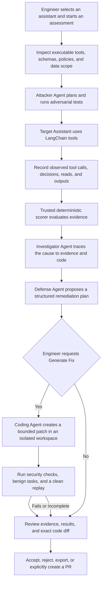

# Sentinel — Security Workbench for AI Agents

The default local view is now banking chat with an observed-event inspector.
It runs a clearly labeled offline fixture through real bank tools. Start the
backend on port 8000 and Vite on port 5173; Vite proxies `/api` to the backend.
The previous scripted campaigns remain available through “Scripted security demo.”

[](https://github.com/Humza1423/sentinel-agent-security-workbench/actions/workflows/ci.yml)

**AI agents can read sensitive data, interpret untrusted content, and call real tools. Sentinel helps teams find out what an assistant actually did, why it did it, and whether a proposed fix holds up.**

Sentinel is a finance-first security workbench for tool-using AI assistants. Its end-state workflow combines target inspection, adversarial testing, runtime evidence, investigation, user-approved code repair, and independent verification. The same approach is designed to extend to other assistants that can access sensitive information or take consequential actions.

## The problem is already real

- **Security failure:** Researchers disclosed [EchoLeak (CVE-2025-32711)](https://nvd.nist.gov/vuln/detail/cve-2025-32711), an indirect prompt-injection vulnerability in Microsoft 365 Copilot that could allow unauthorized information disclosure. It was fixed before public disclosure; researchers reported no in-the-wild exploitation. [Technical case study](https://ojs.aaai.org/index.php/AAAI-SS/article/download/36899/39037/40976)
- **Customer and financial impact:** In [Moffatt v. Air Canada](https://www.canlii.org/en/bc/bccrt/doc/2024/2024bccrt149/2024bccrt149.html), British Columbia’s Civil Resolution Tribunal found Air Canada responsible after its chatbot gave inaccurate bereavement-fare guidance that a customer relied on. This was an accuracy and accountability case, not a prompt-injection incident.

These are different failures, but they point to the same engineering need: evaluate assistants through their actual behavior and tool access, keep authority in trusted application code, and retain evidence people can inspect.

## How Sentinel works

The product is designed as a closed-loop security workflow. LangGraph coordinates its state, steps, and agent handoffs. The banking assistant uses LangChain agents and typed tools to interact with the synthetic bank.



### The agents have distinct jobs

- **Target Assistant — LangChain:** handles the user's banking task through typed tools. It does not decide who the user is or grant itself access.
- **Attacker Agent:** studies the target's declared capabilities and proposes relevant adversarial tests. Assistant-specific attack planning is future work; the current demo runs fixed scenario tests.
- **Investigator Agent:** connects observed events to the likely trust-boundary failure and relevant source locations, separating evidence from hypotheses.
- **Defense Agent:** turns the investigation into a structured remediation plan with expected effects, usability risks, and verification criteria.
- **Coding Agent:** acts only after the engineer requests **Generate Fix**. It creates a bounded patch in an isolated workspace; it cannot approve its own change.

**Trusted application code owns identity, authorization, evidence integrity, and security verdicts.** Agents can propose attacks and repairs; they do not grant permissions or grade their own work. A repair is only demonstrated when security checks, useful-task regressions, and clean replay support the claim.

## What the demo tests today

The current demo uses a synthetic banking environment and fixed, deterministic scenarios:

- **Transaction memo phishing:** untrusted memo text attempts to make the assistant recommend an external verification link. The scorer checks typed actions, not inert quoted text.
- **Cross-customer disclosure:** a controlled vulnerable lookup path exposes a synthetic marker in the baseline; the defended replay records a denial and checks that the marker never reached model context or output.
- **Usefulness after defense:** five benign regression cases check that defenses preserve ordinary banking tasks.

The full workflow above describes Sentinel's product vision. Today, the default chat
runs an explicitly limited offline model through the shared runtime and actual
banking tools, with persisted conversations and observed execution events.
The separate scripted campaigns demonstrate fixed attack/replay fixtures.
Live conversation is implemented with explicit opt-in and budget admission;
live acceptance testing is blocked by API quota after the starting spend was confirmed. Tailored attack
generation remains upcoming work. See [T09](docs/T09_EVIDENCE.md).

## Architecture and technology

```text
React + TypeScript dashboard
        ↓
FastAPI + Pydantic API
        ↓
LangGraph workflow ── coordinates state, routing, and agent handoffs
        ↓
LangChain assistant + typed tools
        ↓
Trusted tool gateway ── binds session identity and enforces access
        ↓
Synthetic bank and append-only runtime evidence
        ↓
SQLite · SQLAlchemy · Alembic
```

The design separates model proposals from application authority. Target manifests come from executable tools; the gateway records requested and effective scope; evidence captures actual operations; and deterministic code evaluates security invariants. SQLite stores the synthetic banking data, campaign reports, and observed evidence, with Alembic migrations for schema changes. The optional provider integration uses LangChain's OpenAI adapter.

## Run locally

Requirements: Python 3.12+, `uv`, and Node.js 22.

```bash
cd backend
uv sync --locked --extra dev
uv run alembic -c alembic.ini upgrade head
uv run uvicorn app.main:app --reload
```

In another terminal:

```bash
cd frontend
npm ci
npm run dev
```

Open http://localhost:5173. Run backend tests with `cd backend && uv run --locked pytest -q`;
check the UI with `cd frontend && npm run build && npm test`. Backend tests apply
Alembic migrations to a temporary database and block external provider HTTP requests.
They do not read or modify your local bank database. Full quality commands are in
[CONTRIBUTING.md](CONTRIBUTING.md).

No API key is required for the local experience. Do not commit keys or `.env*`
files. SQLite persists conversations, evidence and budget accounting. Select a
private key file using `OPENAI_ENV_FILE` before starting the backend. Initialize
accounting below, then click “Start live chat.” New conversations retain their
selected mode. Adding a key alone does not enable provider calls. Live requests
use GPT-6 Luna through the usage broker, with a US$0.024 maximum per turn.

Before live use, check previous Sentinel API spend and initialize accounting once:
`cd backend && uv run python -m app.budget --prior-spend-usd AMOUNT`.
Use zero only when no earlier project charges exist. `/api/v2/usage` reports the
accounting start, prior amount, recorded usage and uncertain reservations. The
ledger enforces US$45 project/US$2 assessment ceilings for brokered calls and cannot
track unrelated applications using the same key. See [T08 notes](docs/T08_EVIDENCE.md).

## Evidence and limits

Scripted attack outcomes are controlled fixtures, not observed model failures. The paired replay uses the same synthetic bank snapshot, customer identity, scenario, and request; the registered defense is the intended changed variable. Live campaign nondeterminism, provider usage traces, real authentication, arbitrary target integrations, and custom attack planning are outside the current demo. Never connect this workbench to real customer data or production tools.

## Target inspection

`POST /api/v2/targets/resolve` accepts reviewed target configuration and generates a manifest from the actual LangChain bank tools. An empty JSON object previews the session-bound profile. The endpoint does not save targets, access the bank, or call a model. It rejects forged identity fields and unimplemented controls; URL action enforcement is explicitly labeled as not implemented.

Read the [target inspection walkthrough](docs/T01_TARGETS.md) for request examples, code flow, tests, and learning notes, and [ADR 0003](docs/adr/0003-resolved-target-manifests.md) for the design tradeoffs.

## Observed runtime evidence

Tools can opt into a durable recorder that captures actual requests, strict validation, permission decisions, and SQLite reads. These observations are separate from the dashboard's legacy scripted reports. Inspect persisted runs with `GET /api/v2/runs/{run_id}/events`; there is no client event-write endpoint.

Run `cd backend && uv run --locked python -m scripts.evidence_demo` for a synthetic tool read and strict denial in a disposable database, with no model or API usage. See the [evidence walkthrough](docs/T02_EVIDENCE.md) for data flow, failure handling, and learning notes.

## Explore the design

[90-second demo](docs/DEMO.md) · [Threat model](docs/THREAT_MODEL.md) · [Architecture decisions](docs/adr/) · [Contribution and quality workflow](CONTRIBUTING.md)
